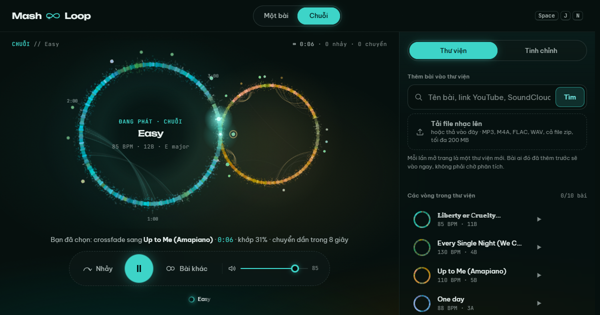

# Mash ∞ Loop

Bài hay thường hết quá sớm. Cái này sửa lỗi đó.

**Nghe thử:** https://mashloop.truclv.com

- [x] **15/10** Bản đầu: lặp vô hạn, nối bài khớp nhịp, màu theo mood, bản web cho nhiều người.
- [x] **16/10** Key lock, tách giọng, 9 kho có sẵn, thêm các kiểu chuyển bài (mashup, double drop, build-up…), bấm vòng để tua.
- [x] **17/10** Chế độ "Như một set DJ", vòng ∞ mới lúc chờ.

Mash ∞ Loop nghe kỹ từng beat của bài hát rồi phát mãi không dứt. Trong một bài, nó
nhảy qua lại giữa những đoạn giống nhau đến mức bạn không biết mình đang ở lần lặp
thứ mấy. Phần ăn tiền là ở **giữa các bài**: khi đã ở đủ lâu, nó tìm chỗ nối sang bài
khác, khớp nhịp, nắn tempo, giữ mood, rồi mix sang như một DJ không biết mỏi tay.



Mỗi bài là một vòng của dấu ∞, mang màu của mood bài đó. Chỗ hai vòng chạm nhau là
chỗ mix, và ánh sáng đi qua điểm giao để chạy sang vòng của bài sau. Tên app, logo
và màn hình chính là cùng một hình vẽ, chuyện này có chủ ý.

## Nó làm gì

- **Mash cả thư viện thành một chuỗi.** Không chỉ lặp trong một bài như
  [Infinite Jukebox](https://musicmachinery.com/2012/11/12/the-infinite-jukebox/) ngày
  xưa: ở mỗi bài một lúc, rồi đi tới điểm nối tốt gần nhất sang bài khác.
- **Mười ba kiểu nối bài và mười cách blend**, từ nối thẳng không lộ tới mashup
  kiểu DJ (bảng bên dưới). Bật tắt từng kiểu trong *Tinh chỉnh*.
- **Nắn tempo mà giữ tông (key lock).** Lệch tới 8 % vẫn blend được, kể cả nhịp đôi
  70 ↔ 140, và giọng ca sĩ không bị bổng hay trầm đi. Lệch xa hơn (tới 18 %) thì bài
  trước kéo tempo dần về phía bài sau. Hai bài lệch tông thì bài sau được dịch tới hai
  nửa cung cho hợp, rồi trượt dần về tông gốc.
- **Nối vào đúng đoạn:** ra ở cuối câu nhạc, vào đầu điệp khúc hay chỗ drop của bài
  sau, không chỉ vào đầu bài.
- **Chọn tiêu chí cho bài kế tiếp:** cân bằng, cùng mood, cùng nhịp, hợp tông (vòng
  Camelot của DJ), như một set DJ (khởi động, lên dần tới đỉnh, cứ vài bài lại có
  một khoảng nghỉ rồi lên lại), hoặc tự do. Tiêu chí nào cũng nhìn trước một bước:
  không chọn bài mà từ đó chỉ còn cách crossfade đi tiếp.
- **Biết ai đang hát:** không nhảy từ giọng nam sang giọng nữ giữa câu, không cắt
  ngang một câu hát, không để hai giọng hát chồng nhau. Có stem giọng hát riêng nên
  blend được chỉ phần nhạc, hoặc để giọng bài sau hát trên nền bài trước.
- **Mỗi bài một màu theo mood**, cả căn phòng đổi màu theo bài đang phát và chuyển
  dần sang màu bài sau trong lúc mix. Có quầng phổ âm thanh quanh vòng đang phát.
  Thích yên tĩnh thì chọn Neon hoặc Hổ phách trong *Tinh chỉnh*.
- **Nhiều nguồn:** link YouTube (cả playlist), SoundCloud, Bandcamp, Zing MP3,
  Mixcloud; gõ tên bài để tìm trên YouTube; hoặc thả file nhạc, cả nguyên file zip.

## Các kiểu nối bài

| Kiểu | Khi nào | Nghe ra sao |
|---|---|---|
| Nối thẳng | Hai đoạn nghe gần như y hệt nhau | Không nhận ra là đã đổi bài |
| Drop | Cùng groove, cùng cường độ, cùng mood | Bài mới vào đúng phách đầu câu nhạc |
| Blend | Nhịp khớp được (lệch tới 8 %, kể cả nhịp đôi 70 ↔ 140) | Mix kiểu DJ, khóa nhịp từng beat, 2 đến 32 ô nhịp |
| Crossfade dài | Hai bài khác mood | 5 đến 11 giây, lọc âm: bài cũ tối dần, bài mới sáng dần |
| Echo | Cuối một câu hát | Bài cũ tan thành tiếng vọng của chính nó |
| Wash | Cuối một đoạn | Bài cũ chìm vào reverb, bài mới bước ra từ đó |
| Build-up | Vào một đoạn drop hay điệp khúc | Bài cũ mỏng dần dưới tiếng gió dâng lên, bài mới nổ vào cùng một cú impact |
| Flanger | Cuối một câu | Bài cũ quét tiếng phản lực rồi đi |
| Ngắt lặng | Bài cũ đang to, bài mới vào mạnh | Im đúng một nhịp, rồi bài mới vào trên phách mạnh |
| Phanh đĩa, cuộn nhịp, spinback, gate | Khi bạn muốn | Đột ngột. Tắt sẵn, bật trong *Tinh chỉnh* nếu thích kịch tính |

Mười cách blend: dài, đổi EQ (bass, mid, treble lần lượt), ngắn, quét filter, đổi chỗ
ở drop, trao giọng (tách giọng), acapella (giọng bài sau hát trên nền bài trước, nhạc
bài sau lên dần bên dưới), mashup (như acapella nhưng trọn 16–32 ô nhịp), double drop
(hai đoạn drop nổ cùng lúc),
và vòng lặp (lặp vài ô nhịp bài trước làm outro cho những bài không có outro).

Khi hai bài lệch tempo, bài sau vào đúng tốc độ bài trước rồi trượt dần về tốc độ
gốc, giữ nguyên tông nhờ time-stretch. Hai bài lệch tông hẳn thì không blend, hai bộ
trống chưa khớp nhịp thì không crossfade chồng lên nhau.

## Dùng bản trên web

Mở https://mashloop.truclv.com. Mỗi lần mở trang là một thư viện mới, trống trơn,
của riêng bạn. Chưa biết thêm gì thì mở một trong 9 kho có sẵn: Pass The Aux (làm
bằng Suno), Pop, Rock, Hip-hop, Electro & Dance, Chill & Lofi, Acoustic, Remix
ccMixter, Kevin MacLeod. Tám kho sau là nhạc Creative Commons từ Jamendo, ccMixter và
Incompetech, có ghi tên tác giả. Nghe hết một kho thì nó tự nối sang kho kế, hoặc
bấm *Kho khác*.

- Mỗi thư viện tối đa 10 bài tự thêm. Bài người khác đã thêm trước đó thì vào ngay,
  không phải chờ phân tích; bài mới mất chừng 20 giây.
- File âm thanh không ai nghe trong 12 giờ thì tự xoá. Trang không lưu dữ liệu cá
  nhân nào, và là dự án vui, phi thương mại.
- Bấm lên vòng để phát từ đoạn đó (vào ngay ở nhịp kế tiếp, không lệch nhịp). Rê
  chuột lên một chấm bên ngoài vòng để xem nó dẫn tới bài nào, bấm để tự chọn điểm
  chuyển. `Space` phát / dừng, `J` nhảy ngay, `N` sang bài khác.

## Chạy trên máy mình

Đã chạy trên Windows 11 với Python 3.13 và một card NVIDIA. Không có GPU vẫn chạy
được, chỉ là mỗi bài phân tích lâu hơn.

Cần sẵn: Python 3.11 trở lên, [ffmpeg](https://ffmpeg.org/) trong `PATH`, và
[Node.js](https://nodejs.org/) 20+ (yt-dlp dùng nó để giải mã trình phát của YouTube).

```powershell
python -m venv .venv
.venv\Scripts\pip install torch==2.6.0 torchaudio==2.6.0 --index-url https://download.pytorch.org/whl/cu124
.venv\Scripts\pip install --no-deps beat-this demucs
.venv\Scripts\pip install -r requirements.txt
.\run.ps1          # mở http://127.0.0.1:8765, tự tắt server cũ nếu còn chạy
```

Lần phân tích đầu tiên sẽ tải model Beat This! và Demucs (khoảng 160 MB). Chạy trên
máy mình thì là bản cá nhân: một thư viện, giữ lại giữa các lần mở, không giới hạn
số bài. Chưa thử trên macOS hay Linux; lệnh tương đương là
`python -m loopbox.server --open`.

Dòng lệnh, nếu bạn thích:

```powershell
.venv\Scripts\python -m loopbox.cli add "Daft Punk Get Lucky audio" "https://www.youtube.com/playlist?list=..."
.venv\Scripts\python -m loopbox.cli list
.venv\Scripts\python -m loopbox.cli rejump     # tính lại điểm nhảy từ dữ liệu đã lưu
.venv\Scripts\python -m loopbox.cli relink     # tính lại điểm nối giữa các bài
```

## Dựng cho nhiều người

Đặt `MASHLOOP_MULTIUSER=1` là thành bản cho nhiều người: mỗi lượt truy cập một thư
viện riêng, bài hát và điểm nối giữa từng cặp bài là kho chung trên server.
`deploy/` có đủ thứ để dựng trên một máy Ubuntu có GPU:

- `pack.py` đóng gói code, `setup.sh` cài venv, deno và service systemd (app chỉ
  nghe trên `127.0.0.1`).
- `haproxy.cfg` và `haproxy-setup.sh`: HAProxy đứng trước, TLS bằng Let's Encrypt tự
  gia hạn.
- `seed_samples.py`: biến một file zip nhạc thành thư viện mẫu. `seed_cc.py`: dựng
  các kho nhạc Creative Commons từ Jamendo, ccMixter và Incompetech.
- `mashloop.service`: số bài phân tích song song, giới hạn mỗi thư viện, dung lượng
  kho nhạc, tất cả là biến môi trường.

Bản trên web có vài lớp chống lạm dụng, để nó không thành một dịch vụ tải nhạc miễn
phí: giới hạn số bài mỗi thư viện, giới hạn theo IP cho tìm kiếm, bài mới, file tải
lên và lượt tải audio, link chỉ nhận từ các trang kể trên, và audio chỉ gửi cho đúng
thư viện đang giữ bài, đã xáo trộn bằng khoá của lượt truy cập đó.

## Bên trong

Mỗi bài đi qua một dây chuyền nhỏ (`loopbox/analysis/`):

1. **Beat This!** dò beat và downbeat. Model trả về theo lưới 20 ms; một bước tinh
   chỉnh kéo từng beat về đúng đỉnh onset, còn lệch khoảng 0.7 ms.
2. **Demucs** tách trống, bass, giọng hát và phần còn lại.
3. Mỗi beat được mô tả bằng hòa âm (lấy từ phần không có trống), âm sắc, độ lớn,
   nhịp điệu bên trong beat, mức của từng stem, và giọng hát: cao độ cùng âm sắc của
   riêng stem vocal. Mood của cả bài (năng lượng, độ tươi) suy ra từ trống, tempo,
   độ sáng và trưởng/thứ.
4. Key đoán bằng profile Albrecht-Shanahan trên stem hòa âm và bass. Đoạn và câu nhạc
   tìm từ ma trận tự tương đồng.
5. Điểm nhảy là cặp beat mà cả cửa sổ 8 beat quanh chúng khớp nhau, cùng vị trí
   trong câu nhạc 4 ô nhịp, có crossfade riêng cho từng chỗ (12 ms nếu trống chắc,
   tới 60 ms nếu là nốt ngân). Đoạn cuối bài được nối cầu để không thành cái bẫy.
6. Điểm nối giữa hai bài được tìm và lưu cho từng cặp, nên một cặp chỉ tính một lần
   cho tất cả mọi người. Phân tích chạy song song ở nhiều tiến trình dùng chung GPU.

Phần phát (`web/js/`) là Web Audio API thuần, lên lịch trước 0.6 giây và chính xác
tới từng mẫu. Đường tới điểm chuyển bài được tìm bằng Dijkstra trên đồ thị nhảy.
Không framework, không build step.

## Kiểm tra

Vì không ai ngồi nghe 3 tiếng liền để test được, nên có mấy công cụ làm việc đó:

```powershell
node tools\sim_player.mjs 180 chain                 # mô phỏng 3 giờ phát trong vài giây
$env:CRITERION="tempo"; node tools\sim_player.mjs 360 chain   # ... với một tiêu chí chọn bài
.venv\Scripts\python tools\e2e_test.py 240          # chạy UI thật trong Chrome, ghi âm output ra WAV
.venv\Scripts\python tools\eval_splices.py          # điểm nhảy khác bản gốc bao nhiêu
.venv\Scripts\python tools\eval_voice.py            # nhảy đổi ca sĩ, cắt giữa câu, giữ câu nhạc
.venv\Scripts\python tools\link_report.py           # thư viện được nối với nhau tốt cỡ nào
```

Trên thư viện thử 14 bài, mô phỏng 6 giờ cho mỗi tiêu chí: *cùng mood* làm độ lệch
mood mỗi lần đổi bài giảm từ 0.49 xuống 0.31 (chọn bừa là 0.76), *cùng nhịp* giữ beat
liền ở 68 % số lần đổi bài với độ lệch tempo trung bình 4.5 %, *hợp tông* cho 85 %
cặp tông hợp nhau. Phát thật 4 phút trong Chrome không rớt tiếng nào.

## Nói thật

- Các con số ở trên là đo bằng máy. Tai người vẫn là trọng tài cuối cùng.
- Key lock chạy [signalsmith-stretch](https://github.com/Signalsmith-Audio/signalsmith-stretch)
  trong trình duyệt, trễ chừng 0.12 giây, nên máy yếu có thể thấy nặng trong lúc blend.
- Zing MP3 chập chờn: nhiều bài chỉ dành cho tài khoản VIP. SoundCloud có bài chỉ cho
  nghe thử 30 giây, những bài đó bị từ chối.
- Không có Suno: audio của Suno được mã hóa, và app không phá lớp bảo vệ đó. Có file
  nhạc của mình thì cứ thả vào.
- Lớp xáo trộn audio chặn được công cụ tải và việc lưu file vu vơ, không phải DRM:
  trình duyệt bắt buộc phải nhận được âm thanh thì mới phát được.
- Chọn bản "audio" trên YouTube sẽ tốt hơn bản MV có đoạn mở đầu dài.

## Bản quyền

Repo này không chứa bất kỳ file nhạc nào. Nhạc bạn tải về nằm trong `data/` và không
đi đâu cả. Dùng cho mục đích cá nhân, tôn trọng điều khoản của các trang nhạc và
quyền của nghệ sĩ.

## Cảm ơn

[The Infinite Jukebox](https://musicmachinery.com/2012/11/12/the-infinite-jukebox/) của
Paul Lamere và [Eternal Jukebox](https://github.com/EternalBox/EternalJukebox) đã nghĩ ra
trò này trước. Phần nặng nhất là của [Beat This!](https://github.com/CPJKU/beat_this),
[Demucs](https://github.com/facebookresearch/demucs), [librosa](https://librosa.org/) và
[yt-dlp](https://github.com/yt-dlp/yt-dlp).

## License

[MIT](LICENSE). Áp dụng cho code trong repo này; nhạc bạn tải về vẫn thuộc về người
làm ra nó.

## English, briefly

An endless jukebox that mashes songs together. It analyses beats, stems, singers and
mood, loops each song through its own seamless jump points, and mixes a library into
one continuous set: beat-matched, key-locked blends (ten styles, stem-aware, with key
shifts and tempo ramps), mashups and double drops, long filtered crossfades between
moods, DJ accents (build-ups, flangers, drop-outs), and a chain that can follow mood,
tempo, key, or nothing at all. Try it
at https://mashloop.truclv.com (a fresh private library per visit, songs from YouTube,
SoundCloud, Bandcamp, Zing MP3, Mixcloud or your own files), or run it on your own
machine. The UI is in Vietnamese; the code and its comments are in English.
